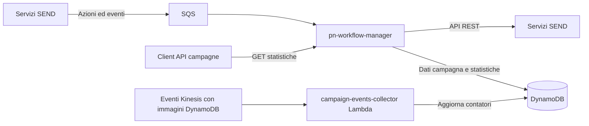

# pn-workflow-manager

## Indice
- [Descrizione](#descrizione)
- [Tecnologie Utilizzate](#tecnologie-utilizzate)
- [Architettura](#architettura)
- [Interfacce del Servizio](#interfacce-del-servizio)
- [Configurazioni](#configurazioni)
- [Allarmi e Monitoraggio](#allarmi-e-monitoraggio)
- [Esecuzione](#esecuzione)

## Descrizione
Il servizio coordina i workflow delle notifiche SEND e le relative elaborazioni asincrone: riceve azioni e aggiornamenti di stato tramite code, interagisce con i servizi della piattaforma per gestire notifiche, documenti, timeline e canali di invio, e persiste i dati di campagna su DynamoDB. Espone inoltre un'API per consultare le statistiche aggregate delle campagne; una funzione Lambda aggiorna tali statistiche a partire dagli eventi di timeline.

## Tecnologie Utilizzate

### Stack Tecnologico
- Java 21 e Spring Boot per il servizio HTTP e i consumer SQS.
- Spring Cloud Stream e Spring Cloud AWS per l'integrazione con i messaggi.
- Node.js e AWS SDK for JavaScript v3 per la funzione di raccolta degli eventi di campagna.
- Maven e npm per build e test.

### Infrastruttura
- AWS SQS per le code di azioni e degli eventi di workflow.
- AWS Lambda per l'elaborazione degli eventi di campagna.
- AWS DynamoDB per i dati delle campagne, le statistiche e la deduplicazione.
- Eventi Kinesis contenenti record con immagini DynamoDB per alimentare il collector.

## Architettura
Il servizio Java riceve azioni e aggiornamenti dagli altri componenti tramite SQS, coordina i workflow e usa API REST interne e DynamoDB per svolgere le elaborazioni. Il collector Lambda aggrega gli eventi di campagna e aggiorna la tabella delle statistiche; l'API di consultazione legge gli stessi dati.



## Interfacce del Servizio

| Tipo | Dir | Risorsa | Protocollo | Metodo | Route | Descrizione |
|------|-----|---------|------------|--------|-------|-------------|
| API | IN | API statistiche campagne | REST | GET | `/workflow-private/informal/{campaignId}/statistics` | Restituisce i contatori aggregati della campagna. [Specifica OpenAPI](docs/openapi/campaigns-api-internal.yaml). |
| API | IN | Endpoint applicativo | REST | GET | `/` | Endpoint radice che restituisce lo stato testuale del servizio. |
| API | IN | Actuator | REST | GET | `/actuator/health`, `/actuator/metrics`, `/actuator/loggers` | Endpoint di gestione esposti dalla configurazione Spring. |
| EVENT | IN | `pn.workflow-manager.topics.action-queue` | SQS | CONSUME | — | Azioni di workflow instradate agli handler registrati. |
| EVENT | IN | `pn.workflow-manager.topics.digital-queue` | SQS | CONSUME | — | Aggiornamenti relativi alle notifiche digitali. |
| EVENT | IN | `pn.workflow-manager.topics.analog-queue` | SQS | CONSUME | — | Aggiornamenti relativi al canale cartaceo. |
| EVENT | IN | `pn.workflow-manager.topics.io-queue` | SQS | CONSUME | — | Esiti relativi ai messaggi App IO. |
| EVENT | IN | `pn.workflow-manager.topics.informal-queue` | SQS | CONSUME | — | Eventi di visualizzazione delle notifiche informali. |
| EVENT | IN | `pn.workflow-manager.topics.safe-storage-events` | SQS | CONSUME | — | Eventi di Safe Storage relativi ai documenti gestiti dal workflow. |
| EVENT | IN | `pn.workflow-manager.topics.national-registries-to-workflow-manager` | SQS | CONSUME | — | Risposte delle richieste inviate ai registri nazionali. |
| API | OUT | Action Manager | REST | POST | `/action-manager-private/action` | Registra un'azione pianificata. |
| API | OUT | External Channels | REST | PUT | `/external-channels/v1/digital-deliveries/legal-full-message-requests/{requestIdx}`, `/external-channels/v1/digital-deliveries/courtesy-full-message-requests/{requestIdx}`, `/external-channels/v1/digital-deliveries/courtesy-simple-message-requests/{requestIdx}` | Invia notifiche legali e messaggi digitali di cortesia. |
| API | OUT | IO Connector | REST | POST | `/io-connector/message` | Richiede l'invio di un messaggio tramite App IO. |
| API | OUT | National Registries | REST | POST | `/national-registries-private/{recipient-type}/addresses` | Richiede gli indirizzi del destinatario. |
| API | OUT | Paper Channel | REST | POST | `/paper-channel-private/v1/paper-deliveries-prepare/informal` | Richiede la preparazione di una comunicazione cartacea informale. |
| API | OUT | Safe Storage | REST | POST | `/safe-storage/v1/files/{fileKey}` | Aggiorna i metadati di un file. |

Il collector Lambda elabora inoltre batch Kinesis con record contenenti `dynamodb.NewImage`; questo protocollo non rientra tra i valori ammessi per la colonna `Protocollo` dello schema SEND.

## Configurazioni

| Nome | Sorgente | Valori | Descrizione |
|------|----------|--------|-------------|
| `PN_WORKFLOWMANAGER_CAMPAIGNS_TABLE_NAME` | ENV | `pn-Campaigns` (default) | Nome della tabella DynamoDB usata per recuperare i dati delle campagne. |
| `CAMPAIGN_STATISTICS_TABLE` | ENV | `pn-CampaignStatistics` (default) | Tabella DynamoDB aggiornata dal collector e letta dall'API delle statistiche. |
| `CAMPAIGN_EVENTS_DEDUPLICATION_TABLE` | ENV | `pn-CampaignEventsDeduplication` (default) | Tabella DynamoDB usata per i lock di deduplicazione degli eventi di campagna. |
| `CAMPAIGN_EVENTS_DEDUPLICATION_TTL_DAYS` | ENV | `7` (default) | Durata in giorni dei lock di deduplicazione. |
| `DEDUPLICATION_MANAGEMENT_ENABLED` | ENV | `false` (default) | Abilita la gestione dei lock per evitare la doppia elaborazione degli eventi. |
| `CAMPAIGN_MONITORING_DIGITAL_CHANNELS` | ENV | `["IO","EMAIL","PEC","SMS"]` (default) | Canali digitali riconosciuti per l'aggregazione delle statistiche. |
| `CAMPAIGN_MONITORING_ANALOG_CHANNELS` | ENV | `["RS"]` (default) | Tipi di invio analogico riconosciuti per l'aggregazione. |
| `CAMPAIGN_MONITORING_VIEW_CHANNELS` | ENV | `["IO","WEB"]` (default) | Canali di visualizzazione riconosciuti per l'aggregazione. |
| `CAMPAIGN_MONITORING_DELIVERED_CHANNELS` | ENV | `["IO","EMAIL","PEC","SMS","ANALOG"]` (default) | Canali di consegna riconosciuti per l'aggregazione. |

## Allarmi e Monitoraggio

| Tipo | Nome | Descrizione |
|------|------|-------------|
| LOG | Log applicativi `pn-workflow-manager` | I consumer registrano gli esiti delle elaborazioni e gli errori; i log supportano la diagnosi dei workflow non completati. |
| LOG | Log `campaign-events-collector` | La funzione registra errori, timeout e record o campagne falliti; le informazioni consentono di individuare batch con elementi da riprocessare. |

## Esecuzione

Prerequisiti: Java 21, Node.js e npm.

Build del servizio Java:

```bash
./mvnw clean package
```

Test del servizio Java:

```bash
./mvnw test
```

Avvio locale del servizio Java:

```bash
./mvnw spring-boot:run
```

Build, test e coverage della funzione Lambda, dalla directory `functions/campaign-events-collector`:

```bash
npm install
npm test
npm run build
```

---

| Documentazione | Valore |
|----------------|--------|
| Ultimo aggiornamento | 2026-11-08 |
| Commit di riferimento | ae403112072630c8e752531c535b34262ae0d064 |
